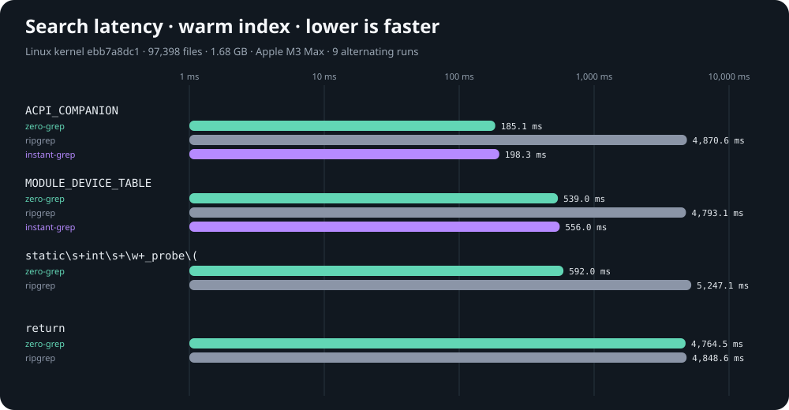

# zero-grep

**Fast, indexed code search for large repositories.** `zg` is a cross-platform Rust grep CLI for developers and AI coding agents. It builds a local n-gram index, prunes files that cannot match, then verifies every candidate with a regular-expression scan.



On a pinned Linux kernel checkout (97,398 files, 1.68 GB) on an Apple M3 Max, warm `zg` searches were 8.9–26.3× faster than ripgrep for three selective queries, while matching its output exactly. A common `return` query was effectively tied. The first index build took 9.8 seconds; the index is local and stays fresh by checking file metadata on each search. [Full results and method](benchmarks/README.md).

## Install

```sh
brew install ml-lubich/tap/zero-grep
# or use the Python package for a managed CLI
uv tool install zero-grep
# or install into an active Python environment
pip install zero-grep
# install directly from the Rust source
cargo install --git https://github.com/ml-lubich/zero-grep
```

Both install the short `zg` command. The uv entry point is a thin Python launcher into the same Rust engine.

## Search

```sh
zg 'ACPI_COMPANION' .
zg 'static\s+int\s+\w+_probe\(' src
zg -i 'unsafe' crates
zg --no-index 'return' .
```

`zg PATTERN [PATH ...]` uses regular expressions, follows `.gitignore`, skips hidden files and binary content by default, and prints matching file, line number, and line. It automatically builds `.zero-grep/` on the first directory search; changed and new files are searched directly until the index is rebuilt.

| Option | Effect |
|---|---|
| `-i`, `--ignore-case` | Case-insensitive matching |
| `-H`, `--hidden` | Include hidden files |
| `--no-ignore` | Ignore `.gitignore` rules |
| `--index` | Rebuild the local index |
| `--no-index` | Full scan without an index |
| `-j`, `--threads` | Set worker count |
| `-q`, `--quiet` | Exit status only |
| `-l`, `--files-with-matches` | Print only matching file paths |

## How it works

The index stores selective three-byte grams in compact, delta-encoded posting lists. Regex syntax is parsed to find required grams; alternations keep only grams common to every branch. Broad postings are omitted, which keeps the index smaller; if a pattern has no selective grams, `zg` safely scans the files. Candidate files always go through the Rust regex engine, so the index only removes impossible files and never supplies results itself.

## Platform and performance

The same Rust implementation builds on macOS, Linux, and Windows. The regex engine uses optimized automata on each target CPU; the index uses memory-mapped tables and postings. macOS-specific code is not required.

The published comparison includes ripgrep and the open-source instant-grep implementation. It does not compare Cursor’s hosted product: Cursor has not published a standalone binary that can run against the same local checkout. Full output parity was checked before timing. The regex case is compared only with ripgrep because instant-grep produced extra cross-line matches for that pattern.

## Development

```sh
cargo fmt --check
cargo test
cargo clippy --all-targets -- -D warnings
cargo llvm-cov --summary-only --fail-under-lines 95
```

MIT licensed. Contributions welcome.
