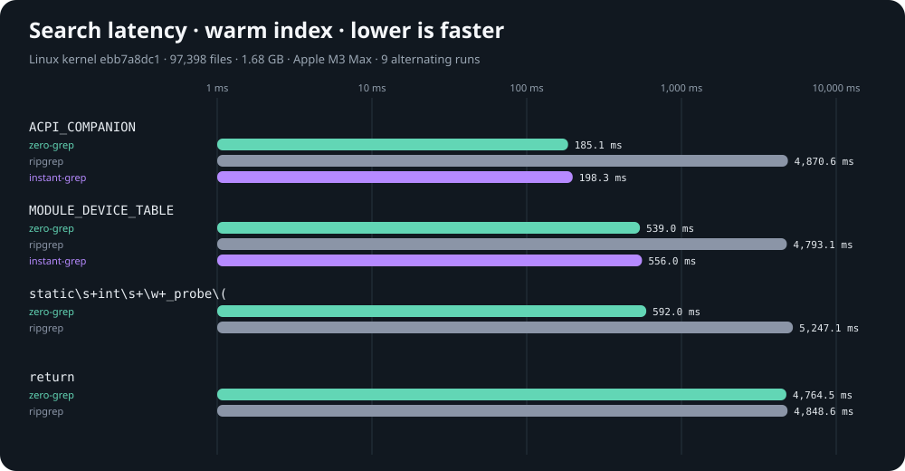

# Benchmarks

Measured on Apple M3 Max (macOS-15.5-arm64-arm-64bit-Mach-O), 97,398 tracked files / 1.68 GB, Linux kernel commit `ebb7a8dc1e74c705daffe11c2faf38ec2628f838`. Release builds; warm page cache and warm indexes; 9 alternating runs; median wall time. The harness verifies exact output equality with `rg -n` before timing.

| Pattern | zero-grep | ripgrep | instant-grep | zero-grep vs rg |
|---|---:|---:|---:|---:|
| `ACPI_COMPANION` | 185.1 ms | 4,870.6 ms | 198.3 ms | 26.31× |
| `MODULE_DEVICE_TABLE` | 539.0 ms | 4,793.1 ms | 556.0 ms | 8.89× |
| `static\s+int\s+\w+_probe\(` | 592.0 ms | 5,247.1 ms | not measured | 8.86× |
| `return` | 4,764.5 ms | 4,848.6 ms | not measured | 1.02× |

Index build, separately measured on the same corpus: zero-grep 9,791 ms; instant-grep 5,346 ms.

Common terms still scan most files, so the index offers little benefit there. Query regexes with only broad grams also fall back to a full scan. Results are hardware and corpus specific; use the included script to reproduce.

Run: `python3 scripts/bench.py 'ACPI_COMPANION' /path/to/linux --instant-grep /path/to/instant-grep --json /tmp/result.json`.
